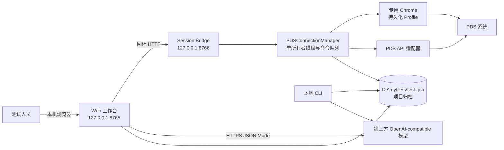
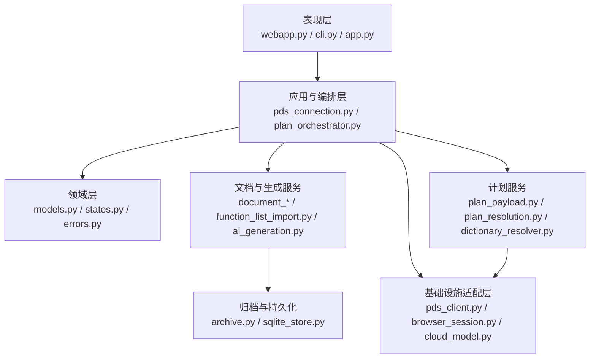
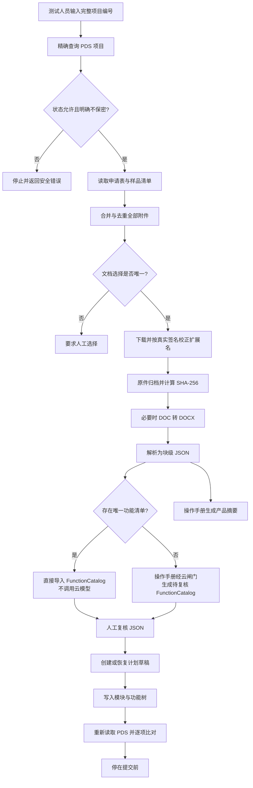
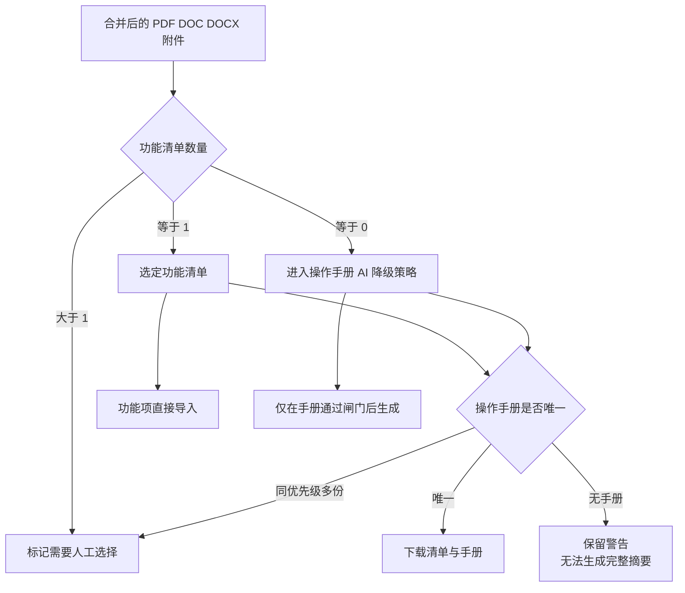
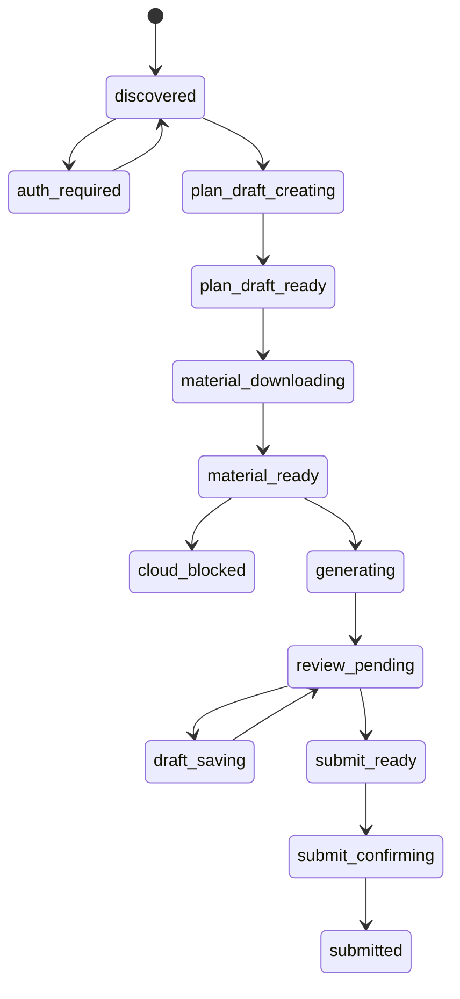
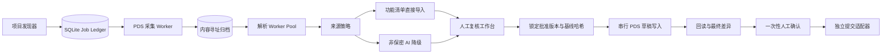

# PDS 登记测试自动化 Harness 技术架构报告

> 报告日期：2026-11-11  
> 评估对象：`pds-registration-harness` 当前工作区代码、配置、自动化测试与本地真实归档  
> 当前包版本：`pyproject.toml` 为 `0.3.0`（`src/pds_harness/__init__.py` 仍为 `0.1.0`，属于版本标识漂移）  
> 结论口径：本报告只描述已经存在于代码或已留有运行证据的能力；规划中的能力单独标注，不视为已实现。

## 1. 执行摘要

当前系统不是一个已经完成全部产品化闭环的“一键登记测试机器人”，而是一套已经具备真实 PDS 草稿操作能力、强调安全闸门与可追溯性的本地工程 Harness。

现有架构的主干已经成立：

1. 使用本地 FastAPI Web 工作台作为操作入口；
2. 使用独立 Session Bridge 持有唯一的专用 Chrome/PDS 会话；
3. 通过 PDS 内部接口读取项目、申请表、样品附件、字典及计划数据；
4. 将原始文档、转换件、解析结果和生成结果按项目及 SHA-256 归档；
5. 优先从“功能清单/功能列表”确定性生成结构化功能项 JSON；
6. 操作手册用于产品摘要、背景理解和人工核查，只有缺少功能清单时才进入 AI 生成功能项的降级路径；
7. 先创建或恢复“计划与记录”草稿，再把 JSON 功能树映射为 PDS 的 `itemType=2 → itemType=3` 结构；
8. 保存后重新读取 PDS 并比对功能树；
9. 提交接口虽然存在于适配层，但运行开关、Bridge 和 Web 路由都没有开放提交，当前实战全部停在提交前。

当前成熟度可概括为：

| 能力 | 当前状态 | 证据/说明 |
|---|---|---|
| PDS 专用会话与自动登录 | 已实现 | 持久化 Chrome Profile、`.env` 凭据、人工登录回退、登录后自动最小化 |
| 项目材料读取与下载 | 已实现并实战验证 | 合并申请表附件与样品清单；校验项目、状态、保密状态和附件身份 |
| 功能清单直接导入 | 已实现并实战验证 | 5 个真实项目完成 34–43 个功能项的草稿写入 |
| 操作手册产品摘要 | 已实现为服务和 CLI | Web 能读取已生成摘要，但尚无 Web 生成按钮或统一编排 |
| 缺少功能清单时 AI 生成功能项 | 核心服务已实现 | 尚未形成完整生产 UI 和人工编辑/批准闭环 |
| 新增/恢复计划草稿 | 已实现并实战验证 | 默认参数、当前登录用户、空测试日期、草稿唯一性闸门 |
| 功能项写入及回读核对 | 已实现并实战验证 | 保存后逐项核对模块、功能名和说明 |
| 自动发现全部“待计划编制”项目 | 有领域服务，未接入主 UI | 当前工作台仍由测试人员手工输入项目编号 |
| 持久化工作流调度 | 数据结构已实现，主链路未接入 | 状态机与 SQLite Store 目前仅被单元测试使用 |
| 最终人工确认与提交 | 未完成 | 没有提交路由；`submit_enabled=false`；客户端强制关闭 |
| Cron Scheduler | 未实现 | 按既定决策留待后续稳定阶段 |

因此，当前最准确的定位是：**可用于受控实战、能够创建和修改 PDS 草稿、但还没有完成生产级任务编排与最终提交闭环的本地安全型自动化 Harness。**

## 2. 业务目标与系统边界

### 2.1 目标业务流程

目标流程是将原先依赖测试人员人工完成的以下工作自动化：

1. 识别“待计划编制”的软件产品登记测试项目；
2. 读取《软件测评服务申请表》，获得单位名称、领取人电话、软件名称、版本和保密状态；
3. 下载项目材料；
4. 提供产品功能摘要和原文查看入口；
5. 从权威功能清单直接导入功能项，或在确无功能清单时根据操作手册生成待人工复核功能项；
6. 新增或恢复“计划与记录”，写入测试默认参数；
7. 写入结构化功能项草稿并回读核对；
8. 测试人员确认客户约定日期、全部参数、项目编号和功能项差异；
9. 确认后提交。

### 2.2 当前已经覆盖的边界

当前代码覆盖第 2–7 步的大部分工程能力，并完成了真实草稿写入。第 1 步已有解析服务但未进入操作界面；第 8 步只有零散的 JSON 校验、摘要展示和原文链接，没有完整的复核工作台；第 9 步被主动关闭。

### 2.3 当前明确不做的事情

- 不绕过 PDS 验证码或其他安全机制；
- 不把保密状态不是精确“不保密”的材料发送给云模型；
- 不在附件身份不匹配时自动选择或写入；
- 文档策略层在多份同类主文档存在时标记“需要人工选择”；当前采集与写入层还没有完成强制闭环，详见第 7.3 和第 22 节；
- 不自动填写尚未与客户确认的测试日期；
- 不调用 PDS 提交接口；
- 不承诺 PDS 未公开接口的长期兼容性；
- 不提供多用户、集中式或远程部署能力。

## 3. 架构原则

### 3.1 本地优先

PDS 会话、原始材料、解析结果、结构化 JSON 和草稿操作均在当前 Windows 电脑完成。云模型只处理明确为“不保密”且通过身份与完整性校验的操作手册内容。

### 3.2 JSON 是唯一功能项数据源

`FunctionCatalog` 是功能项的规范数据模型。PDS 功能树不是从 Word 表格直接拼接请求，而是经过：

`原始文档 → 解析产物 → FunctionCatalog JSON → 确定性校验 → PDS Payload`

这使功能项可以被检查、对比、版本化和重复生成。

### 3.3 权威来源优先

功能清单是功能项的第一来源。操作手册不再默认驱动 AI 生成功能项，以避免模型对已有权威数据进行不必要的改写。

### 3.4 失败关闭

状态不明确、保密状态不明确、项目编号不唯一、附件身份不匹配、草稿不唯一、下载内容类型不可信或回读不一致时，系统停止，而不是继续猜测。

### 3.5 草稿可恢复、提交不可逆

提交前可以反复读取和保存草稿，因此当前架构优先完成草稿自动化；提交后无法修改，所以最终提交保持独立的高风险边界。

## 4. 系统上下文



这个边界设计中最关键的一点是：Web 工作台不直接获得 PDS Token。Token 由专用 Chrome 的 `sessionStorage` 提供，只在 Session Bridge 进程内用于构造 PDS 请求。

## 5. 进程与部署架构

### 5.1 推荐启动方式

`start-harness.ps1` 启动两个本地进程：

| 进程 | 地址 | 作用 | 生命周期 |
|---|---|---|---|
| Session Bridge | `127.0.0.1:8766` | 持有 Chrome、Token、PDS Client 与串行操作队列 | 后台隐藏启动，工作台重启时可继续存活 |
| Web 工作台 | `127.0.0.1:8765` | 显示状态、触发操作、查看归档、校验 JSON | 前台运行 |

启动脚本会先探测 Bridge 的 `/health`；若未运行，则后台启动并最多等待约 10 秒；随后把 `PDS_SESSION_BRIDGE_URL` 注入 Web 工作台进程。

### 5.2 单进程降级模式

如果没有设置 `PDS_SESSION_BRIDGE_URL`，Web 工作台会在自身进程中构造 `PDSConnectionManager`。这种模式适合开发，但工作台重启会同时丢失浏览器会话，因此不是当前推荐方式。

### 5.3 会话持久化

专用 Chrome Profile 位于：

```text
D:\myfiles\test_job\pds-browser-profile
```

它与日常 Chrome Profile 隔离。登录流程如下：

1. 启动持久化 Chrome；
2. 打开 PDS 登录页；
3. 若已有有效 `pro_token`，直接进入 ready；
4. 否则从本地 `.env` 读取 PDS 用户名与密码并尝试自动登录；
5. 若选择器变化、验证码出现或登录失败，保留可见窗口供人工处理；
6. 检测到 Token 后通过 Chrome DevTools Protocol 最小化专用窗口。

窗口最小化失败只影响体验，不会使已建立的会话失效。

## 6. 代码分层与模块职责



### 6.1 表现层

| 文件 | 当前职责 | 备注 |
|---|---|---|
| `src/pds_harness/webapp.py` | FastAPI 工作台、HTML/JS 页面、Web API、归档文件读取 | 当前主要 UI；页面仍偏工程控制台 |
| `src/pds_harness/bridge_app.py` | Session Bridge API | 不提供 Token 读取端点 |
| `src/pds_harness/cli.py` | JSON 校验、配置检查、文档解析、功能清单导入、产品摘要生成 | AI 摘要当前主要通过 CLI 生成 |
| `app.py` | 早期 Streamlit 校验界面 | 不是当前推荐主入口，和 FastAPI 工作台并存 |

### 6.2 领域层

`domain/models.py` 使用 Pydantic 严格模型，全部设置 `extra="forbid"`，避免未知字段静默进入核心数据。

核心领域对象包括：

- `ParsedManualArtifact`：已验证身份、哈希、解析来源、保密状态和生成许可的说明书；
- `FunctionCatalog`：项目、来源哈希、Prompt 版本、模型、模块、功能、覆盖决策和告警；
- `ProductSummary`：产品概述、核心能力、来源块及原始文档地址；
- `RegistrationDefaults`：登记测试默认参数；
- `SubmissionApproval` / `ReviewChecklist`：未来提交所需的人工确认契约；
- `PlanRuntimeValues`：当前登录用户、编制日期和测试日期；
- `PendingProject`、`AttachmentMetadata`、`PlanSummary`：PDS 数据的领域化表示。

### 6.3 PDS 编排层

`PDSConnectionManager` 是当前系统事实上的核心应用服务。它负责：

- 建立和关闭浏览器会话；
- 检测认证状态；
- 精确查找项目；
- 收集申请表、附件、单位与联系电话；
- 下载、归档、转换和解析文档；
- 检查、创建或恢复计划草稿；
- 写入功能目录并回读比对；
- 将所有浏览器/PDS 操作串行化。

该文件约 1510 行，已经同时承担会话管理、项目进件、文档管道、计划写入和大量 PDS 响应解析，功能正确性较集中，但也是目前最明显的结构性复杂度热点。

### 6.4 文档与生成服务

| 模块 | 职责 |
|---|---|
| `document_strategy.py` | 合并附件、分类、决定功能项来源策略 |
| `attachment_selection.py` | 兼容旧流程的单一说明书优先级选择 |
| `document_parser.py` | PDF/DOCX 文本块抽取、页码/章节/表格保留、OCR 风险提示 |
| `legacy_word.py` | 通过 Microsoft Word COM 将 `.doc` 转换为 `.docx`，强制关闭宏 |
| `function_list_import.py` | 将功能清单表格确定性转换为 `FunctionCatalog` |
| `generation_gate.py` | 校验原件哈希、身份、用途限制和云调用资格 |
| `ai_generation.py` | 生成产品摘要或 AI 功能项复核包 |
| `catalog_validation.py` | 重复、来源、结论性语言、动宾结构、置信度和覆盖检查 |

### 6.5 计划服务

| 模块 | 职责 |
|---|---|
| `dictionary_resolver.py` | 通过 PDS 字典标签解析实际 ID，避免硬编码运行值 |
| `plan_resolution.py` | 判断创建、恢复或多个草稿歧义 |
| `plan_payload.py` | 写入默认值、生成 `itemType=2/3` 功能树、计算规范化哈希 |
| `plan_orchestrator.py` | 创建或恢复草稿、保存并做项目/计划身份回读检查 |

### 6.6 基础设施层

| 模块 | 职责 |
|---|---|
| `adapters/browser_session.py` | Playwright 持久化浏览器、登录、Token 获取、窗口最小化 |
| `adapters/pds_client.py` | PDS HTTP 接口、下载安全、提交总开关 |
| `adapters/session_bridge_client.py` | 只允许连接回环地址的 Bridge 客户端 |
| `adapters/cloud_model.py` | OpenAI-compatible JSON Mode 客户端 |
| `services/archive.py` | 原件与解析 JSON 的安全、内容寻址、原子写入 |
| `storage/sqlite_store.py` | 工作流运行账本；当前未接入主链路 |

## 7. 当前主业务数据流

### 7.1 端到端流程



当前代码并没有一个统一的事务或后台任务把上述所有节点一次性编排起来。文档准备、摘要 CLI、计划创建、功能项写入是相互独立的操作；真实实战由操作者按顺序触发。

### 7.2 项目读取与客户联系信息

主路径 `prepare-documents` 使用项目编号做精确匹配，要求：

- 编号符合 `STS` 加 7 位数字；
- 查询结果恰好只有一个精确项目；
- 状态为“待计划编制”或“待提交”；
- PDS `wasKeepSecret` 明确为 `0`，即“不保密”。

系统随后从项目行或申请表中读取单位名称，并扫描申请表字段寻找电话。电话选择采用字段路径评分：包含领取/接收语义的电话字段优先，传真字段排除；若同分候选不唯一，则返回候选字段但不武断选值。

### 7.3 附件合并与文档来源策略

主路径会合并：

- 《软件测评服务申请表》相关附件；
- 最新样品清单附件。

去重键是“文件名大小写折叠 + 远端路径”。文档按文件名分为：

- `function-list`：功能清单、功能列表、功能项清单、功能项细则；
- `manual`：用户手册、操作手册、产品说明书、软件说明书、厂商手册、设计说明书；
- `supporting`：其他材料。



需要注意两个实现边界：

1. 兼容端点 `/prepare` 仍保留早期的 `program_attachments or sample_attachments` 逻辑；生产主路径 `/prepare-documents` 才是合并两个来源的新架构。后续应删除或明确废弃旧端点，避免调用方误用。
2. `plan_project_documents` 在多份同类文档时会返回 `human_selection_required`，但当前采集函数仍会下载和解析候选文档，并可能把最后生成的目录放入响应中的 `function_catalog` 字段。它不会自动写 PDS，但也没有阻止调用方随后选择该目录写入。因此“多文档必须人工选择”目前是策略信号，不是端到端强制闸门。

### 7.4 下载与文件类型校验

PDS 下载不是直接信任附件 URL：

1. 先向 PDS 请求临时下载票据；
2. 再读取文件服务配置；
3. 票据必须是相对路径；
4. 拼接后的目标必须与受信文件服务同源；
5. 最大下载大小为 250 MiB；
6. HTML、JSON、XML 响应被拒绝；
7. 通过魔数或 ZIP 内部结构识别 PDF、DOC、DOCX；
8. 声明扩展名与内容签名不一致时，按内容签名归档。

### 7.5 身份一致性闸门

附件文件名会与项目软件名称比较。比较过程去掉版本号、说明书通用词和“软件/系统/平台”等通用后缀，再判断包含关系或字符串相似度；当前阈值为 `0.68`。

这是启发式安全闸门，不是业务主数据的强关联。它能阻断明显的跨项目附件，但仍可能产生误报或漏报。身份不匹配材料只有在显式确认后才能作为“异常样本”下载和解析，且解析 JSON 中写入：

```json
{
  "identity_match": false,
  "function_generation_allowed": false,
  "usage_restriction": "exception_sample_only"
}
```

`generation_gate` 会再次检查这些字段，因此异常样本不能经受控 AI 生成路径进入功能目录。但是当前 `write-function-catalog` 接口只检查目录中的项目编号、项目 ID 和内容规则，没有验证目录 SHA-256 是否来自当前项目的已批准归档；理论上可以绕过生成闸门提交一份手工构造的同项目 JSON。正式提交前需要把“批准的来源 Manifest”强绑定到写入请求。

## 8. 文档解析与功能项生成架构

### 8.1 解析模型

PDF 以页为块，保留页码；DOCX 按文档顺序抽取段落和表格，识别标题并记录当前章节。每个块都有稳定的 `block_id`，例如：

- `page-0001`
- `paragraph-00001`
- `table-00001`

解析器会检查 Unicode 替换字符、私用区字符和控制字符。PDF 每页文本少于 40 字时标记 `needs_ocr=true`，但当前没有集成 OCR 执行器。

### 8.2 旧版 Word 转换

`.doc` 文件通过本机 Microsoft Word COM 转换为 `.docx`：

- Word 不可见；
- 禁止宏；
- 只读打开；
- 不加入最近文档；
- 原件和转换件分开存储。

因此，同一份材料存在 `.doc` 原件和 `.docx` 转换件不是重复下载，而是“原始证据 + 可解析派生物”。新目录结构已经通过 `original/derived/parsed` 明确区分两者。

### 8.3 功能清单直接导入

导入器定位同时包含“软件功能项目”和“功能说明”的表格，自动识别功能说明列，并把之前的层级列解释为：

- 第一个非空层级：PDS 模块；
- 最深的非空层级：PDS 功能；
- 功能说明列：PDS `testExplain`。

该算法兼容目前出现的三列和四列表格。若同一模块下功能名重复，会使用功能说明进行确定性消歧。当前直接导入器底层使用 `python-docx`，因此只真正支持 DOCX，以及先转换成 DOCX 的旧版 DOC；如果功能清单是 PDF，采集和解析可以完成，但直接导入会失败。直接导入结果具有以下标识：

```json
{
  "prompt_version": "direct_function_list_v1",
  "model": "none-direct-function-list"
}
```

同时生成 `review_manifest.json`，明确 `cloud_model_used=false` 和 `pds_write_allowed=false`，表示生成完成后仍需人工复核。当前写入端点尚未读取该 Manifest，所以这仍是审计声明，不是技术上强制的批准状态。

### 8.4 AI 产品摘要

`generate_product_summary_artifact` 只生成：

- 150–500 字产品功能介绍；
- 核心能力列表；
- 来源 `block_id`；
- 原始文档绝对路径。

服务会拒绝模型引用不存在的 `block_id`。工作台的 review-package 接口会再次校验 `source_document_path` 必须位于归档根目录且文件存在，然后提供可点击查看链接。

### 8.5 AI 功能项降级路径

当没有功能清单时，`ai_generation.py` 提供两种生成方式：

1. 单次生成完整摘要、模块、功能和覆盖关系；
2. 分段生成：先规划功能域，再逐模块生成，降低长文档请求规模。

共同规则包括：不得虚构、功能说明使用动宾结构、禁止结论性语言、合并重复操作、排除联系方式和纯说明信息、每项必须引用真实来源块。

生成结果全部为 `review_status="pending"`，不会自动批准。

### 8.6 确定性校验

`CatalogValidator` 当前检查：

- 模块重复；
- 同模块功能名重复；
- “正常、正确、成功、通过、符合要求”等结论性词语；
- 功能说明是否可能不是动宾结构；
- 来源引用是否存在；
- 置信度是否低于 0.60；
- 可选的章节覆盖缺口。

对于权威功能清单的直接导入，原文中的结论性词语降级为复核告警，不阻止写入；对于 AI 生成目录则仍是阻断错误。这一差异是有意设计的：系统可以忠实搬运客户的权威清单，但不能让模型主动生成不合规措辞。

## 9. 结构化数据模型

### 9.1 FunctionCatalog

```text
FunctionCatalog
├─ schema_version = 1.0
├─ program_id / program_code
├─ manual_sha256
├─ prompt_version / model
├─ modules[]
│  ├─ local_id / name / source_refs[]
│  └─ functions[]
│     ├─ local_id / name / description
│     ├─ source_refs[]
│     ├─ confidence
│     └─ review_status
├─ coverage[]
└─ warnings[]
```

`manual_sha256` 在直接导入场景实际表示“功能清单来源 SHA-256”，字段命名仍沿用了早期只处理说明书的设计，语义已经不够准确，建议后续迁移为 `source_sha256`。

### 9.2 PDS 功能树映射

`build_function_tree` 将目录映射为：

```text
模块 itemType=2
└─ 功能 itemType=3
```

字段映射为：

| JSON | PDS |
|---|---|
| `module.name` | 模块节点 `testItem` |
| `function.name` | 功能节点 `testItem` |
| `function.description` | 功能节点 `testExplain` |
| 模块根节点 | `parentItemCode="0"` |
| 功能父节点 | 模块 `itemCode` |

节点编码根据 `program_id + plan_id + item_type + position + name` 确定性生成。当前使用 MD5 作为稳定标识算法，不用于密码学安全。

### 9.3 产品摘要

`ProductSummary` 包含概述、核心能力、来源块和原始文档路径。摘要不参与功能树写入，只服务于测试人员理解产品和核查原文。

### 9.4 Review Manifest

Manifest 用来描述生成批次、来源、模块/功能数量、校验问题、云模型使用情况和复核状态。当前它还是文件级元数据，没有被状态机或 Web 审批界面消费。

## 10. 本地存储架构

### 10.1 新目录结构

```text
D:\myfiles\test_job\<项目编号>\
├─ documents\
│  ├─ function-list\
│  │  ├─ original\       # PDS 原件
│  │  ├─ derived\        # DOC 转换后的 DOCX
│  │  └─ parsed\         # 结构化解析 JSON
│  └─ manual\
│     ├─ original\
│     ├─ derived\
│     └─ parsed\
├─ generation\
│  └─ <来源 SHA-256>\
│     ├─ direct_function_list_v1\
│     │  ├─ function_catalog.json
│     │  └─ review_manifest.json
│     └─ product_summary_v1\
│        └─ product_summary.json
└─ review_blocker.json     # 安全阻断时生成
```

当前 `review_blocker.json` 已在真实异常项目中作为运行记录使用，但创建它的逻辑尚未进入 `pds_harness` 主代码；它不是每次阻断都会自动生成的标准产物。后续应由持久化 Job/审计服务统一写入。

### 10.2 内容寻址与写入安全

- 原件文件名含 SHA-256 前 12 位；
- 解析 JSON 使用完整 SHA-256 命名；
- 已存在原件会重新计算哈希，冲突或外部修改会报错；
- 原件和解析 JSON 使用临时文件、`fsync` 和原子替换；
- 文件名会移除 Windows 非法字符并处理保留名称；
- 所有归档路径在写入前验证不能逃逸归档根目录。

### 10.3 现存旧目录

早期流程使用：

```text
<项目>/manuals/original
<项目>/manuals/derived
<项目>/manuals/parsed
```

部分项目还保留旧 AI 生成目录和新直接导入目录。例如 STS1260336 同时存在早期 AI 目录和新 `direct_function_list_v1` 目录。当前没有自动迁移、淘汰标记或唯一“已批准版本”指针，后续必须增加显式的 artifact selection，避免人工或程序选错旧目录。

### 10.4 留存与备份

当前配置为：

- 存储位置：`D:\myfiles\test_job`；
- 留存期限：永久；
- 备份策略：未解决；
- 删除制度：未定义；
- 静态数据加密：未实现。

这符合当前单机试运行决策，但不属于成熟生产数据治理。

## 11. PDS 接口适配

### 11.1 已适配接口

| 业务用途 | PDS 路径 | 类型 |
|---|---|---|
| 项目统计探测 | `/management/queryStatistics/queryStatisticsList` | 读 |
| 计划项目查询 | `/registration/ycsTestPlanRecord/listYcsTestPlanRecord` | 读 |
| 申请表 | `/management/ycsApply/getYcsApplyInfo` | 读 |
| 申请表附件 | `/management/ycsApply/getYcsProgramPdfFiles` | 读 |
| 最新样品清单 | `/management/sampleManage/getLatestYcsProgramSample` | 读 |
| 计划列表 | `/registration/ycsTestPlanRecord/listYcsRegTestPlan` | 读 |
| 计划详情/初始化 | `/registration/ycsTestPlanRecord/getYcsRegPlanInfo` | 读 |
| 保存计划草稿 | `/registration/ycsTestPlanRecord/saveYcsRegPlanInfo` | 写草稿 |
| 提交候选流程 | `/registration/ycsTestPlan/getPlanInfoCandidate` | 读，当前主链路未用 |
| 计划状态条件 | `/registration/ycsTestPlan/initSearchCondition` | 读 |
| 提交计划 | `/registration/ycsTestPlanRecord/submitYcsRegPlanInfo` | 写，不开放 |
| 字典查询 | `/system/dictionary/getDictionaryDataInfoList` | 读 |
| 下载票据 | `/system/file/download` | 读 |
| 文件服务配置 | `/system/file/getKkfileViewUrl` | 读 |

### 11.2 PDS 响应适配策略

PDS 返回结构存在多层 `data`、字段名变化和状态码/状态文本并存的情况。当前代码通过递归遍历和候选字段集合兼容这些差异。这提高了实战适应性，但也意味着接口契约较宽松，PDS 一旦改变结构，错误可能在运行时才暴露。

### 11.3 计划草稿唯一性

计划解析结果有三种：

- `create`：无待提交草稿，可创建；
- `resume`：恰好一个待提交草稿，恢复使用；
- `ambiguous`：多个草稿，停止并要求人工选择。

这避免了同一项目重复创建多个计划。

## 12. 计划默认参数与写入流程

### 12.1 当前默认值

| 参数 | 当前值 |
|---|---|
| 测试规范 | `STS-QI-41-V2.0《软件产品登记测试规范》` |
| 测试方法 | 黑盒测试、文档检查 |
| PDS 方法字典 | 运行时按标签解析；当前对应 `140001`、`140002` |
| 依据标准 | GB/T 25000.51-2016 |
| 现场方式 | 本实验室测试；当前对应 `230001` |
| 测试地点 | 本实验室 |
| 编制人 | 当前登录用户 |
| 测试人员 | 当前登录用户 |
| 监督人员 | `/` |
| 客户人员 | `/` |
| 测试日期 | 空列表，待测试人员与客户确认 |

### 12.2 草稿创建

草稿创建流程：

1. 再次精确查询项目；
2. 要求项目仍处于“待计划编制”；
3. 要求明确“不保密”；
4. 检查是否已有待提交草稿；
5. 若有唯一草稿则恢复，不重新写默认值；
6. 若无草稿，则从 PDS 初始化计划读取当前登录用户名和编制日期；
7. 查询测试方法及现场方式字典；
8. 应用默认值；
9. 保存草稿；
10. 回读并核对 `programId` 和 `planId`。

### 12.3 功能项写入

功能项写入要求：

- 目录项目编号与目标一致；
- 目录 `program_id` 与 PDS 一致；
- 确定性校验无阻断错误；
- PDS 项目处于“待提交”；
- 项目明确“不保密”；
- 恰好存在一个待提交草稿。

写入时读取完整远端计划，只替换 `ycsTestPlanTesItems`，然后保存并再次获取计划。回读比对忽略 PDS 生成的非核心字段，但严格比较节点类型、模块名、功能名、说明和层级结构。

### 12.4 并发修改保护的真实程度

代码中存在 `canonical_plan_hash` 和 `ConcurrentModificationError`，但当前功能项写入主路径没有把人工复核时的计划哈希与保存前远端哈希进行比较。因此当前保护的是“写入后结果一致”，不是完整的“人工复核后远端未被别人修改”的乐观锁。

在单测试人员场景风险较低，但若多人同时修改 PDS，应补充基线哈希/版本号比较。

## 13. 状态机、任务账本与当前接入差距

`domain/states.py` 已定义完整状态机：



多数执行状态还允许转入 `needs_attention` 并从指定检查点恢复。

`SQLiteWorkflowStore` 能创建运行记录、执行受控状态迁移、使用条件更新防止同一运行并发修改，并查询可恢复任务。然而当前代码库中：

- 没有实际 `.db` 文件；
- Web、Bridge 和主编排均未实例化 `SQLiteWorkflowStore`；
- `review_manifest.json` 也没有与状态机联动。

因此状态机与 SQLite 目前是“已实现并通过单元测试的基础组件”，不是实际运行控制面。进程崩溃后的恢复主要依赖 PDS 草稿回读和文件归档，而不是任务账本自动恢复。

## 14. 并发与线程模型

### 14.1 PDS 操作串行化

Playwright 同步 API 具有线程亲和性，而 FastAPI 的同步端点可能在不同线程运行。`PDSConnectionManager` 为此创建唯一 `pds-browser-owner` 线程，并使用 `Queue + Future` 接收命令：

```text
多个 Web 请求
    ↓
内存命令队列
    ↓
唯一浏览器所有者线程
    ↓
Chrome / Token / PDS API / 文档归档
```

优点：

- 不会跨线程误用 Playwright；
- Token 和浏览器生命周期集中；
- 同一会话内不会并发写 PDS；
- 多项目同时触发时仍按队列执行，降低交叉写入风险。

限制：

- PDS 读写、下载、Word 转换和文档解析都在同一所有者线程内，长任务会阻塞后续 PDS 命令；
- 命令队列仅存在于内存，Bridge 崩溃会丢失尚未执行的命令；
- 默认命令超时 180 秒，Bridge 客户端超时 190 秒；
- 当前不能真正并行处理 5 个 PDS 项目，只能并发发起、串行落地。

### 14.2 可并行的部分

在架构上，完成下载和解析后，纯本地 JSON 校验、产品摘要生成和人工复核可以脱离 PDS 所有者线程并行执行。但当前没有后台任务系统自动分离这些阶段。

## 15. 云模型架构

### 15.1 客户端

云客户端是最小化 OpenAI-compatible `/chat/completions` 实现：

- 配置从 `.env` 读取；
- Base URL 必须是 HTTPS；
- 禁止 URL 中携带用户名、密码、查询和片段；
- `trust_env=False`，不继承系统代理；
- `temperature=0`；
- 强制 `response_format={"type":"json_object"}`；
- 默认请求超时 600 秒；
- 错误信息经过简化，不回显 API Key 或响应正文。

当前配置的模型 ID 为 `gpt-5.6-sol`，具体密钥与中转地址不进入本报告。

### 15.2 保密闸门

只有规范化后精确等于“不保密”的项目允许进入云端。缺失、未知或“保密”都默认拒绝。

此外，云生成前还会重新校验：

- 解析 JSON 能通过严格模型验证；
- `identity_match=true`；
- `function_generation_allowed=true`；
- `usage_restriction` 为空；
- 原始文件仍存在；
- 原始文件 SHA-256 与解析 JSON 一致。

### 15.3 当前集成边界

Web 工作台只有模型连通性探测和摘要读取接口，没有摘要生成或 AI 功能项生成路由。生成摘要要使用 CLI，AI 功能项服务目前需要由代码或测试直接调用。这是当前“能力存在但未产品化”的典型部分。

## 16. 安全、隐私与权限设计

### 16.1 已实现控制

| 风险 | 当前控制 |
|---|---|
| PDS Token 泄露 | Token 不返回给 Web、不写数据库和归档；按请求从浏览器内存读取 |
| PDS 会话串线 | 独立 Chrome Profile、单所有者线程 |
| 项目写错 | 精确项目编号、唯一结果、`program_id` 多重校验 |
| 保密材料上云 | 精确“不保密”白名单策略 |
| 附件跨项目 | 文件名与软件身份比较；异常样本用途写入 JSON |
| 下载伪装内容 | 同源限制、大小限制、Content-Type 和文件签名验证 |
| 路径穿越 | 归档写入和本地文件读取都限制在配置根目录 |
| Word 宏 | COM 转换时强制禁用宏 |
| 未经复核写功能项 | 严格 JSON 模型与确定性校验 |
| 错误提交 | 客户端 kill switch、配置关闭、无 Web/Bridge 提交路由 |

### 16.2 当前风险

1. `.env` 以明文保存模型密钥和 PDS 凭据；虽然已被 `.gitignore` 排除，但仍可被同一 Windows 用户读取。
2. 本地工作台和 Bridge 没有应用层认证，依赖只监听回环地址和单机用户假设；本机其他进程仍可调用端点。
3. 归档目录未加密，且当前电脑用户可访问。
4. 永久留存、无备份、无删除制度。
5. Uvicorn 访问日志可能记录项目编号和端点，尚无专门的日志脱敏与轮转策略。
6. PDS 内部接口没有正式版本或兼容性承诺。
7. 附件身份判断是启发式算法，不等价于 PDS 文件与项目的服务端外键约束。

## 17. Web 工作台与 API

### 17.1 当前页面能力

- 查看草稿、提交、云模型开关；
- 启动、检测、探测和停止 PDS 会话；
- 测试模型 JSON Mode；
- 输入项目编号并下载/归档材料；
- 显示已生成产品摘要；
- 点击查看功能清单或操作手册原件；
- 展示默认参数和风险登记；
- 上传功能目录 JSON 做确定性校验。

“创建计划草稿”“写入功能目录”等后端端点已存在，但当前 HTML 页面没有为它们提供完整按钮、参数预览、差异视图和二次确认界面。

### 17.2 Web API 清单

| 方法与路径 | 作用 | 状态影响 |
|---|---|---|
| `GET /health` | 运行开关状态 | 无 |
| `GET /api/archive-file` | 读取归档根目录内文件 | 无 |
| `GET /api/projects/{code}/review-package` | 获取最新摘要及原文地址 | 无 |
| `POST /api/model/probe` | 模型连通性测试 | 外部请求，无 PDS 写入 |
| `GET /api/pds-connection/status` | 会话状态 | 无 |
| `POST /api/pds-connection/start` | 打开/恢复专用会话 | 启动 Chrome |
| `POST /api/pds-connection/probe` | 查询一条项目统计 | PDS 只读 |
| `POST /api/pds-connection/stop` | 关闭专用会话 | 关闭 Chrome |
| `POST /api/projects/{code}/prepare` | 旧版单说明书流程 | 下载归档 |
| `POST /api/projects/{code}/prepare-documents` | 新版文档策略主流程 | 下载、解析、直接导入 |
| `POST /api/projects/{code}/inspect-plan-contract` | 检查计划与草稿 | PDS 只读 |
| `POST /api/projects/{code}/create-plan-draft` | 创建/恢复计划 | 可能写草稿 |
| `POST /api/projects/{code}/write-function-catalog` | 写功能树并回读 | 写草稿 |
| `POST /api/projects/{code}/download-exception-sample` | 显式下载身份不匹配样本 | 仅本地归档 |
| `POST /api/validate-catalog` | 校验目录 JSON | 无 |
| `POST /api/inspect-document` | 临时解析上传 PDF/DOCX | 临时文件，完成后删除 |

## 18. 提交架构与当前禁用状态

`PDSClient.submit_plan` 已实现基本提交调用，要求：

1. `submit_enabled=true`；
2. `SubmissionApproval.is_valid()` 为真；
3. 人工确认产品摘要、计划参数、功能差异和完整检查清单。

但当前真实运行中：

- 配置 `submit_enabled=false`；
- Web 和 Bridge 构造客户端时再次硬编码 `submit_enabled=False`；
- 没有提交 Web/Bridge 路由；
- 没有获取流程候选、展示二次确认和提交后回执的应用编排；
- 没有 UI 创建 `SubmissionApproval`。

因此即使误改 YAML，提交仍不会被现有 Web 流程调用。这是多层 kill switch，而不是单一配置。

## 19. 可恢复性、幂等与故障处理

### 19.1 已实现

- 原件以内容哈希命名，重复下载不会产生不同证据副本；
- 解析 JSON 与来源 SHA-256 绑定；
- 功能树节点编码可确定性重建；
- 已有唯一草稿时恢复使用，不重复创建；
- 功能项保存后回读比对；
- PDS 会话独立于工作台进程，可减少重复登录；
- 预期业务错误转为不含 Token 的领域异常。

### 19.2 不完整之处

- Direct import 和 summary 的固定输出文件使用普通 `write_text`，没有与原件同等级的原子写入和冲突检测；
- AI 完整生成以模型输出哈希作为目录名，完全相同结果重跑会因目录已存在而失败，而不是幂等复用；
- 没有跨“下载—解析—生成—建计划—写功能项”的事务；
- 没有持久化任务队列、自动重试或死信队列；
- SQLite 状态账本未接入；
- 网络中断后的恢复依赖操作者重新触发，系统通过 PDS 草稿和本地文件判断已有结果；
- 没有统一的作业 ID 与结构化操作审计日志。

## 20. 自动化测试与质量现状

### 20.1 当前测试结果

2026-11-11 在当前环境执行：

```text
82 passed in 10.38s
```

测试覆盖配置、状态机、保密策略、附件选择、文档策略、PDF/DOCX 解析、功能清单导入、AI 生成契约、目录校验、计划 Payload、草稿解析、PDS Client、Session Bridge Client、会话管理、归档、SQLite Store 和 Web 基础路由。

### 20.2 测试局限

- 当前环境没有安装 `pytest-cov`，不能提供可信行覆盖率；
- 大部分测试使用 Fake Client 或 Mock Transport，不是实际 PDS 沙箱；
- 新主路径 `prepare_project_documents`、真实草稿创建和功能项写入主要依靠实战验证，自动化单元测试不足；
- 没有覆盖 Chrome 自动登录、验证码回退、窗口最小化的 UI 自动化测试；
- 没有端到端测试覆盖“材料 → 摘要 → 复核 → 计划 → 功能树”；
- 没有并发、长文档、超时、Bridge 崩溃恢复和磁盘空间不足测试；
- 没有 PDS 接口契约快照或回归样本库。

## 21. 当前真实运行证据

截至 2026-11-11，以下项目已使用权威功能清单直接生成目录并写入 PDS 草稿，全部停在提交前：

| 项目 | Plan ID | 模块数 | 功能数 | 来源策略 | 云模型生成功能项 |
|---|---:|---:|---:|---|---|
| STS1260336 | 15200 | 5 | 35 | 直接功能清单 | 否 |
| STS1260341 | 15201 | 6 | 36 | 直接功能清单 | 否 |
| STS1260340 | 15202 | 8 | 43 | 直接功能清单 | 否 |
| STS1260338 | 15203 | 5 | 34 | 直接功能清单 | 否 |
| STS1260337 | 15204 | 11 | 42 | 直接功能清单 | 否 |

共同状态：

- PDS 状态为“待提交”；
- 编制人和测试人员为当时的当前登录用户；
- 测试日期为空；
- 未调用提交接口。

STS1260339 被身份闸门阻断：项目软件与附件软件不一致。系统没有创建计划、没有写入功能项，并保留 `review_blocker.json`。这证明失败关闭路径在真实数据上生效。

## 22. 主要技术债与风险排序

### P0：正式提交前必须解决

1. **缺少统一人工复核与最终确认界面。** 需要一次展示项目编号、单位与电话、测试日期、全部计划参数、功能项增删改差异、原始来源和阻断告警。
2. **提交闭环未实现。** 需要独立的二次确认对象、候选流程读取、一次性确认令牌、提交回执和不可逆操作审计。
3. **新主链路自动化测试不足。** 必须为 `prepare_project_documents`、`create_plan_draft`、`write_function_catalog` 增加完整 Fake 契约与沙箱验收。
4. **多个生成目录缺少唯一批准版本。** 需要 `approved_artifact.json` 或数据库指针，不能依赖“最新修改时间”或人工找目录。
5. **持久化任务状态未接入。** 真实作业需要 SQLite 或其他本地队列记录阶段、输入哈希、输出、错误和重试。
6. **项目自动发现未接入 UI。** 目前仍手工输入项目编号，未完成最初的“自动识别待计划编制项目”。
7. **来源批准没有与写入端点绑定。** 写入请求必须携带批准 Manifest、来源哈希和复核人，并由服务端重算校验，不能只信任调用方提交的 FunctionCatalog。
8. **多文档歧义尚未在采集/写入层硬阻断。** `human_selection_required` 必须成为不可绕过的作业状态，人工锁定候选后才能生成可写目录。

### P1：生产稳定性

1. 拆分 1510 行的 `PDSConnectionManager`，至少分为会话服务、项目读取服务、文档采集服务和计划写入服务；
2. 明确废弃旧 `/prepare` 流程，避免附件来源回退逻辑重现；
3. 将下载/转换/解析移出浏览器所有者线程，只保留 Token 和 PDS HTTP 在串行队列；
4. 增加 PDS 响应契约快照、版本探测和字段变化报警；
5. 增加保存前基线哈希检查，实现真正的乐观并发控制；
6. 使用 Windows Credential Manager 或 DPAPI 替代 `.env` 明文凭据；
7. 增加归档备份、恢复、删除和容量监控；
8. 为本地工作台增加 CSRF/本地认证或随机会话密钥；
9. 增加结构化脱敏日志和按项目的审计记录。
10. 为 PDF 格式功能清单增加表格解析器，或在策略层明确限制为 DOC/DOCX 并转人工处理。
11. 拆分“本地 PDS 处理许可”和“云模型发送许可”。当前文档采集、建计划和写功能项都要求“不保密”，比既定业务规则更严格；若未来要处理保密项目，应允许纯本地直导路径，同时继续禁止任何云调用。

### P2：可维护性与体验

1. 合并 FastAPI 与遗留 Streamlit 入口；
2. 修复版本号不一致：`pyproject.toml=0.3.0`、包内 `__version__=0.1.0`；
3. 修正 Web 页面中“云模型默认关闭”等已与配置不一致的文案；
4. 将 `manual_sha256` 重命名为通用 `source_sha256`；
5. 为扫描版 PDF 接入 OCR；
6. 增加任务队列后再引入 Cron Scheduler；
7. 将项目代码纳入 Git 跟踪并建立可回滚版本基线。当前 `pds-registration-harness` 在父仓库中尚无已跟踪文件和提交历史。

## 23. 推荐演进架构

建议不推翻现有代码，而是在当前安全主干上分四阶段演进。

### 阶段一：完成复核工作台

- 为每个项目建立持久化 Job；
- 自动读取待计划编制项目列表；
- 显示单位、电话、保密状态和全部材料；
- 提供目录表格编辑、原文引用跳转和功能差异；
- 明确选择并锁定 approved artifact；
- 日期必须由测试人员输入并再次确认。

### 阶段二：稳定编排与恢复

- 将状态机和 SQLite 接入所有主路径；
- 每一步记录输入/输出 SHA-256；
- 实现幂等重试与恢复；
- PDS 命令队列只处理远端会话操作，本地解析进入 Worker Pool；
- 增加统一审计日志。

### 阶段三：受控提交

- 提交前重新读取项目和计划；
- 比对人工复核基线哈希；
- 展示不可逆警告和最终完整差异；
- 生成短期、单项目、单计划的一次性确认令牌；
- 打开提交路由，但默认运行开关仍关闭；
- 独立验收后再在生产电脑开启。

### 阶段四：调度与规模化

- 在人工流程稳定后引入 Cron；
- 自动发现新项目但只创建本地待办，不自动提交；
- 增加项目队列、限流、健康监控和失败通知；
- 根据数据治理决定备份、留存和删除策略。

## 24. 推荐的目标编排形态



此目标形态保留当前最有价值的设计：专用会话、Token 隔离、内容寻址、来源引用、功能清单优先、JSON 单一数据源和失败关闭；新增的是持久化编排、明确批准版本、真正的并发控制以及独立提交边界。

## 25. 最终结论

当前项目架构已经从“脚本验证”演进为具有清晰分层、安全闸门和真实 PDS 草稿写入能力的本地 Harness。最强的部分是：

- PDS 会话与 Token 隔离；
- 功能清单优先的文档来源决策；
- 原件、转换件和解析产物分层归档；
- 严格结构化 JSON 与来源追溯；
- 草稿唯一性、项目身份和保密状态校验；
- 保存后回读比对；
- 多层禁用最终提交。

当前最大的缺口不是底层接口是否能用，而是**尚未把已经验证的能力编排成可恢复、可审计、可由测试人员完整复核的一体化产品流程**。在完成复核 UI、持久化任务账本、批准版本锁定、新主链路自动化测试和最终提交安全契约之前，系统适合继续做“提交前草稿自动化”，不宜打开不可逆提交。

